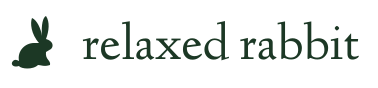
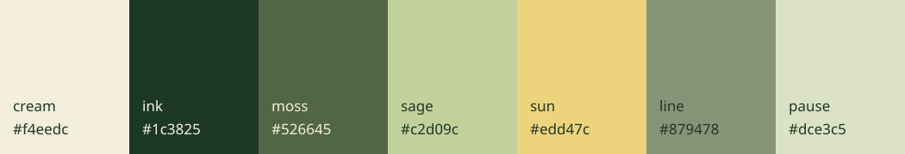

# Relaxed Rabbit brand kit

Read [brand guidelines](../docs/BRAND.md) before using these files.

- `rabbit-mark-{forest,cream,black}.svg`: transparent vector symbol.
- `wordmark-{forest,cream}.svg`: transparent horizontal logo with outlined lettering; no font installation required.
- `app-icon.svg`: the existing cream tile and rabbit, suitable as an icon source.
- `palette.css`: shared production primitives (`--rr-*`), imported by the website.
- `palette.json`: sRGB values for other tools and apps.
- `palette.gpl`: swatches for tools supporting GIMP palettes.
- `palette.svg`: visual color reference.

Import SVG directly into Figma, Illustrator, Inkscape or other vector-aware tools. Export a PNG there at the size required by the destination; keep transparency for standalone marks. All SVG wordmarks contain paths, not externally linked fonts. The wordmark uses Linden Hill Regular outlines; see `public/licenses/` for the font license. The rabbit path comes from the existing website mark. No raster or photo is substituted for the logo.

This folder is a source brand kit, not automatically published by Vite. Only assets referenced by the app or placed deliberately in `public/` are deployed. The palette CSS is bundled because the app imports it. Keep private notes and source prompts out of `public/`.
